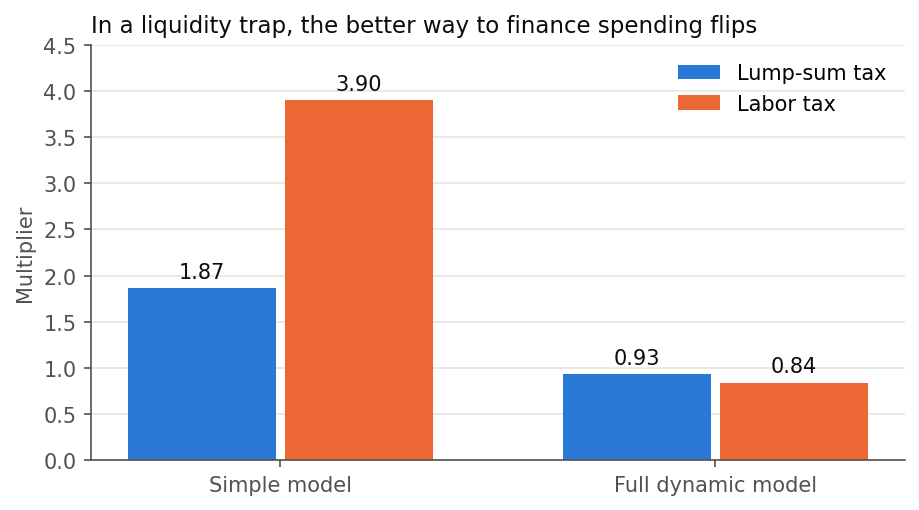

# How financing changes the fiscal multiplier in a liquidity trap

**When interest rates are stuck at zero, does it matter how a government pays for a stimulus plan?**

Yes, and the answer depends on how long the tax lasts. A simple model says a labor tax beats a lump-sum tax in a liquidity trap. A full dynamic model reverses that under a balanced budget, because the tax's effect on inflation outlasts the trap. With debt financing, the result depends on how quickly the tax rises to repay the debt.



*Multiplier in a liquidity trap when all spending is consumption. Simple model: closed-form result. Full model: present value over 500 quarters.*

**[Try the interactive page](https://aaron-analogical.github.io/fiscal-multiplier-liquidity-trap/)** | **[Read the thesis in English](paper/thesis_en.pdf)** | [French original](paper/thesis_fr.pdf)

This is my M.Sc. thesis in Applied Economics (HEC Montréal, 2023), supervised by Hafedh Bouakez, rebuilt as a reproducible project.

## Reproduced results

One command reruns the model and rebuilds every table and figure, then checks them against the numbers printed in the thesis. The thesis used MATLAB; this repo uses free tools.

**66 of 69 checks are within 0.005 of the value printed in the thesis.** The other three are printing errors in the thesis, confirmed by the original results workbooks, and none affects a conclusion:

| Value | Thesis | Rerun | Likely cause |
|---|---|---|---|
| Table 6.1, debt, normal times, 16-quarter build | 0.58 | 0.59 | Copying error in a summary table |
| Simple model, lump-sum, normal times | 0.89 | 0.90 | Rounding error in the text |
| Lump-sum break-even investment share | 0.176 | 0.172 | Transcription error in the text |

Full comparison: [results/validation.md](results/validation.md). Other issues found in the original: [docs/errata.md](docs/errata.md).

## Main results

Present-value multipliers over 500 quarters, in a liquidity trap:

| Spending mix | Lump-sum tax | Labor tax | Debt |
|---|---|---|---|
| Consumption only | 0.93 | 0.84 | 0.57 |
| Investment, 1 quarter to build | 1.88 | 1.76 | 1.54 |
| Investment, 16 quarters to build | 2.20 | 2.11 | 1.81 |

- Spending is more powerful in a trap in most cases, because the central bank does not raise rates in response.
- Public investment has a larger total effect than consumption spending, since it raises future productivity.
- Longer build times raise the multiplier in a trap and lower it in normal times.
- A debt-financed plan can approach or beat lump-sum financing if the tax rises soon and fades quickly. On impact it does so once the tax response to debt exceeds 0.05.

## Method

The model is a New Keynesian DSGE model of a closed economy: households, monopolistically competitive firms with sticky prices, public capital with time to build, a Taylor rule with a zero lower bound, and three financing options that share one steady state. Only spending away from the steady state is financed differently, so differences in the multiplier come from financing alone.

Two versions answer different questions:

1. **Simple model:** linearized, solved by hand. Gives closed-form multipliers and two propositions.
2. **Full model:** non-linear, solved under perfect foresight over 500 quarters across 35 scenario runs. A liquidity-preference shock creates a 12-quarter trap, and the exit is endogenous.

Details: [docs/model.md](docs/model.md).

## Reproduce it

Setup: [docs/setup.md](docs/setup.md). Then:

```sh
.venv/Scripts/python scripts/run_all.py
.venv/Scripts/python -m pytest
node --test tests/simple_model.test.mjs
```

## Repository map

| Path | Contents |
|---|---|
| `model/` | Dynare model and the Octave scenario runner |
| `config/` | Scenario grid and the numbers printed in the thesis |
| `scripts/` | Multipliers, tables, figures, validation, site data |
| `results/` | Regenerated tables, figures, validation report |
| `site/` | Interactive page |
| `paper/` | English thesis (LaTeX and PDF), French original |
| `docs/` | Setup, model explainer, errata |
| `tests/` | Python and JavaScript tests |

## Skills shown

Macroeconomic modeling (DSGE, occasionally binding constraints), numerical solution of non-linear models, closed-form derivation, Python, Dynare and Octave, scientific reproducibility and validation, data visualization, JavaScript.

## Licence

Code: [MIT](LICENSE). Thesis text and PDFs: [CC BY-NC-ND 4.0](paper/LICENSE). The English version is an unofficial translation; the French thesis is the official version.
